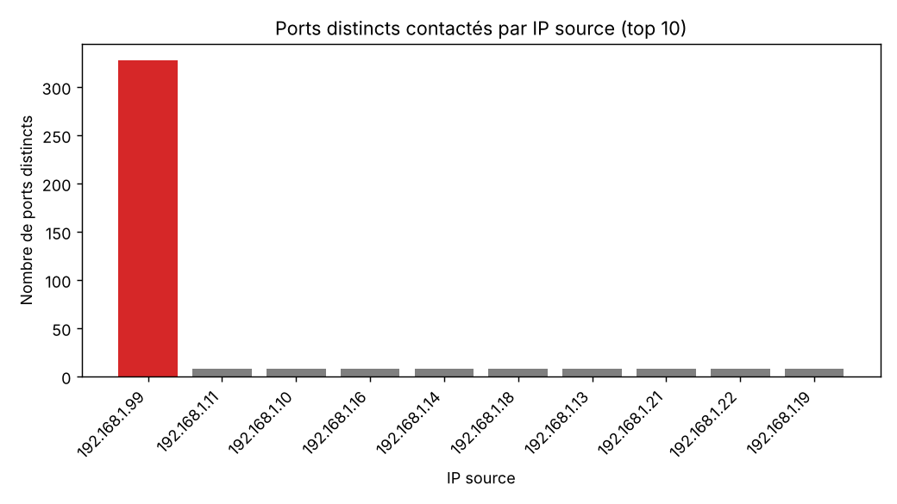
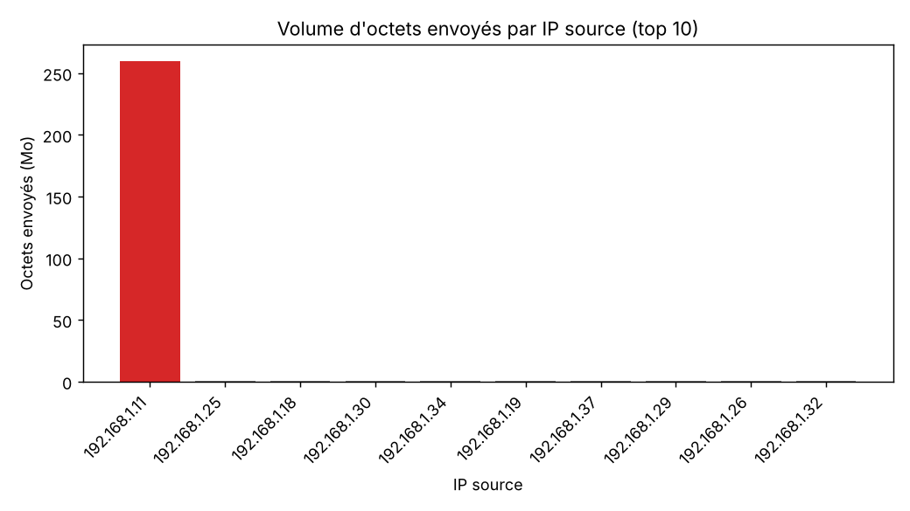
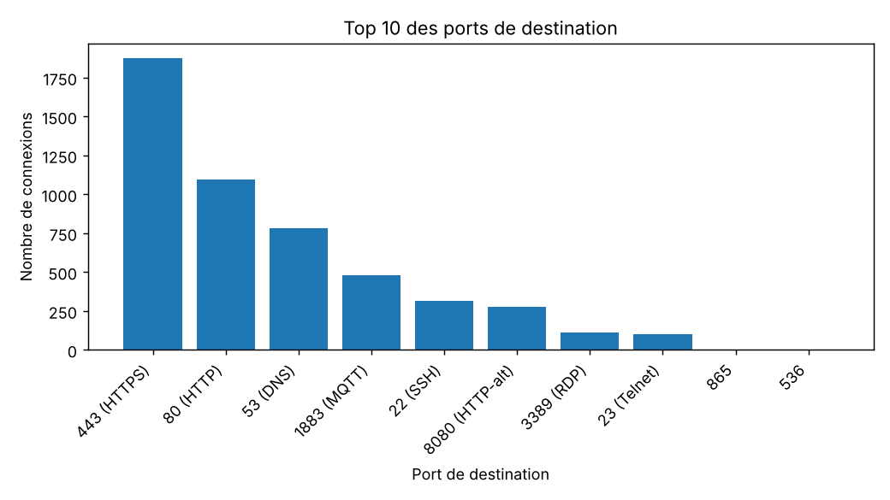
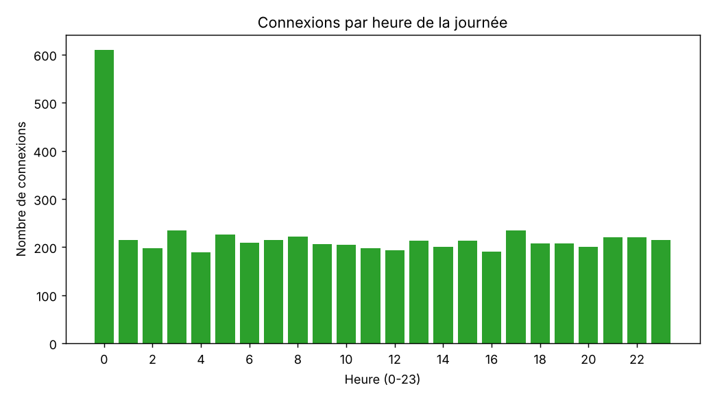
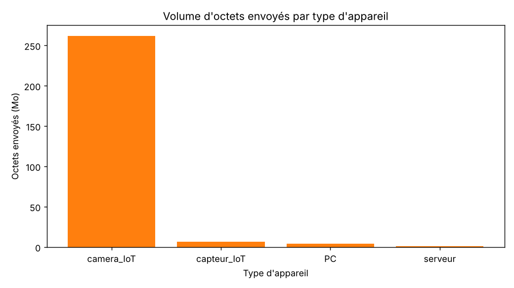
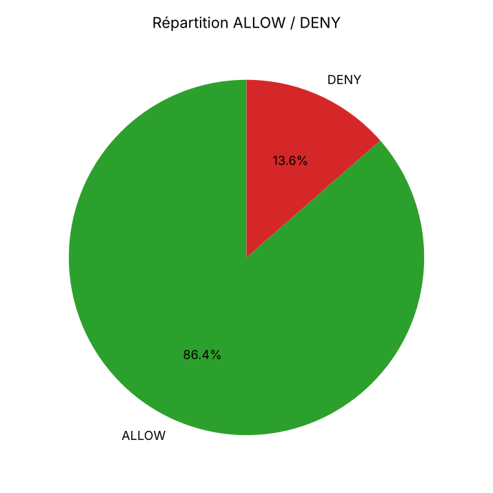

# Rapport d'analyse des journaux du pare-feu

## Sommaire
1. Résumé
2. Nettoyage des données
3. Comportements suspects
4. Recommandations

## 1. Résumé

On a analysé 5440 connexions (5500 lignes brutes avant nettoyage) enregistrées par le pare-feu du 05/10/2026 au 11/10/2026, issues de 31 adresses sources. Le trafic est dominé par le port 443 (HTTPS), et 13.57 % des connexions ont été bloquées. Deux comportements anormaux ressortent : l'adresse 192.168.1.99 a contacté 328 ports distincts, ce qui évoque un balayage de ports, et l'adresse 192.168.1.11 a envoyé 259.9 Mo, ce qui évoque une exfiltration de données. Enfin, on relève 100 tentatives vers Telnet (port 23), protocole non chiffré à proscrire.

| Indicateur | Valeur |
|---|---|
| Lignes après nettoyage | 5440 |
| Port de destination le plus fréquent | 443 (HTTPS) (1874 connexions) |
| Taux de connexions bloquées (DENY) | 13.57 % |
| IP suspectée de scan | 192.168.1.99 |
| IP suspectée d'exfiltration | 192.168.1.11 |

## 2. Nettoyage des données

| Étape | Résultat |
|---|---|
| Doublons exacts supprimés | 60 |
| Protocole mis en majuscules | valeurs : ICMP, TCP, UDP |
| `bytes_sent` manquants remplacés | 163 valeurs, par la médiane (1710 octets) |

## 3. Comportements suspects

### 3.1 Balayage de ports (scan) : 192.168.1.99

- **Preuve :** cette adresse a contacté **328 ports distincts**, contre une médiane de 8 pour l'ensemble des sources (figure `figures/05_ports_distincts_par_ip.png`).
- **Indices complémentaires :** 400 connexions entre le 08/10 à 00:00 et le 08/10 à 00:14, dont 95.8 % bloquées par le pare-feu ; type d'appareil associé : PC. Attention : 17 ports ont tout de même été autorisés, ce qui signifie que des services ont répondu au scanner.
- **Interprétation :** une source qui teste un grand nombre de ports en peu de temps cherche les services exposés. C'est la phase de reconnaissance d'une attaque.

### 3.2 Exfiltration de données : 192.168.1.11

- **Preuve :** cette adresse a envoyé **259.9 Mo**, soit 94.7 % du volume total, contre une médiane de 0.5 Mo par source (figure `figures/06_octets_par_ip.png`).
- **Indices complémentaires :** type d'appareil : camera_IoT ; 38 transferts de plus de 1 Mo (259.5 Mo au total, contre une médiane de 1710 octets par connexion) entre le 10/10 à 00:08 et le 10/10 à 23:53, dont 15 la nuit (22 h à 6 h) ; destination principale : 8.8.8.8 ; port concentrant le volume : 8080 (HTTP-alt) ; 95.4 % des connexions autorisées.
- **Interprétation :** un volume sortant très supérieur aux autres sources, vers une destination récurrente, correspond à un transfert massif de données, possiblement vers l'extérieur.

### 3.3 Autres observations

- Telnet (port 23) : 100 connexions, dont 26 autorisées.
- MQTT (port 1883) : 306 connexions issues d'objets connectés.

## 4. Recommandations

1. **Bloquer et surveiller l'adresse 192.168.1.99** : ajouter une règle DENY sur le pare-feu et activer une détection de balayage (seuil de ports distincts par minute).
2. **Enquêter sur 192.168.1.11** : isoler la machine, identifier le contenu transféré, puis limiter le volume sortant (QoS / seuil d'alerte) et filtrer les destinations autorisées.
3. **Fermer Telnet (port 23)** : le remplacer par SSH (port 22) avec authentification par clé.
4. **Segmenter les objets IoT** (caméras, capteurs) dans un VLAN dédié, avec autorisation limitée aux seuls flux nécessaires (par exemple MQTT vers le broker).
5. **Journalisation et alertes** : centraliser les logs dans un SIEM et créer des alertes sur les pics de trafic hors horaires de bureau.
